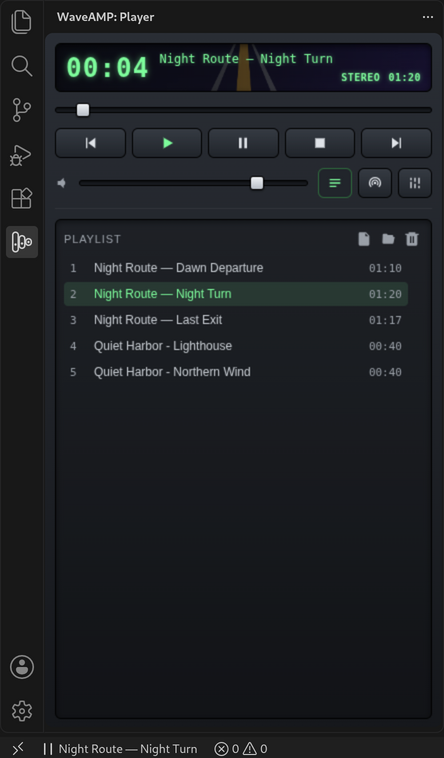
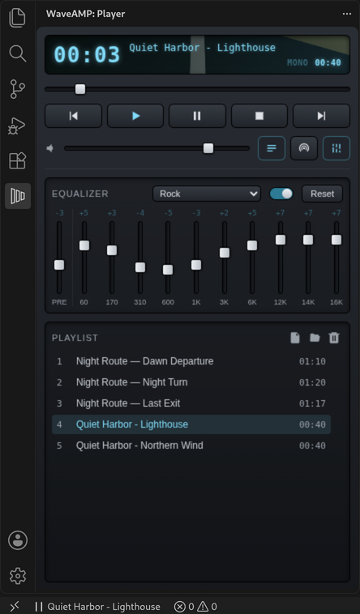
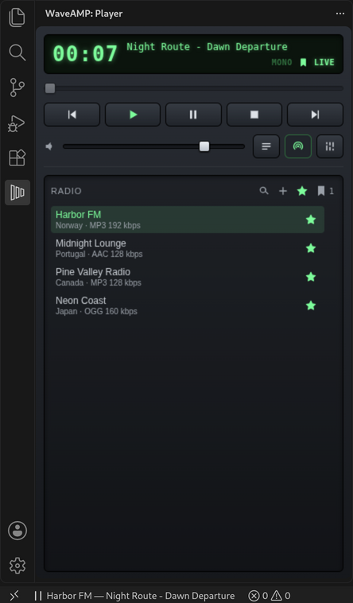
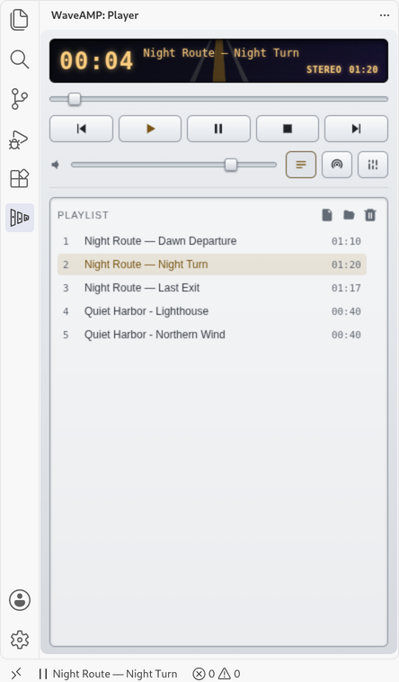
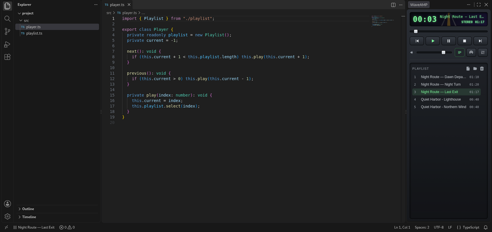

# WaveAMP for VS Code

A music player in the VS Code sidebar. This is the VS Code edition of [WaveAMP](https://github.com/darkdkl/waveamp), a free desktop music player for Windows, macOS and Linux, with the same look, playlist, equalizer and internet radio.

## Features

- **Local files and CUE albums** — add files or whole folders. An album ripped as one file plays as separate tracks from its `.cue` sheet, with seeking inside each track and no gap between them.
- **Tags and cover art** — artist and title from the file tags, and the album cover or the station logo behind the display.
- **10-band equalizer** with a preamp and 18 presets.
- **Stereo widening** for tracks and radio, with a gentle pseudo-stereo effect for mono sources.
- **Internet radio** — search thousands of stations by name, country, region and genre, keep favorites, add your own stations by URL, and see the title of the track that is playing.
- **Saved track titles** — bookmark a song you hear on the radio and copy its title later.
- **Media keys** — play, pause, skip and stop with the media keys on your keyboard or headphones and from the media controls of your system, which also show the title and the cover.
- **Fits your theme** — a light or dark body that follows VS Code, six accent colors, and a status bar button with the current track.

| Equalizer | Radio | Light theme |
| --- | --- | --- |
|  |  |  |

You can drag the WaveAMP icon to the secondary side bar to keep the player next to your code:

## Supported formats

- **Files:** MP3, FLAC, WAV, OGG, OPUS, M4A, M4B and AAC, and CUE sheets for any of them.
- **Radio streams:** MP3, AAC and OGG, including `.pls` and `.m3u` playlist links.

## Getting started

1. Open **WaveAMP** from the activity bar.
2. Add music with the file and folder buttons in the playlist, or open **Radio** and search for a station.
3. Press **▶** in the player. VS Code only lets a panel play sound after you click inside it once per session — after that, the status bar button, the commands and the media keys work too.

## Settings

Open them from the **…** menu of the WaveAMP panel → **Open Settings**.

| Setting | Default | Description |
| --- | --- | --- |
| `waveamp.accentColor` | `classic` | Color of the display and the highlighted controls: Classic, Amber, Ice, Violet, Ruby or Mono. |
| `waveamp.body` | `auto` | Player body: follow the VS Code theme, always dark or always light. |
| `waveamp.coverArt` | `true` | Show the album cover or the station logo behind the display. |
| `waveamp.display.longTitlesScrolling` | `bounce` | How a long track or station title moves on the display: off, in a loop, back and forth, or once. |
| `waveamp.display.scrollingSpeed` | `30` | Scrolling speed of long titles, from `10` (slow) to `50` (fast). |
| `waveamp.radio.showTrackTitles` | `true` | Show the title of the track playing on a radio station. |
| `waveamp.stereo.tracks` | `false` | Make local tracks sound wider in stereo. |
| `waveamp.stereo.radio` | `false` | Make radio stations sound wider in stereo. |
| `waveamp.stereo.strength` | `50` | How much wider, from `0` to `100`. |
| `waveamp.stereo.pseudoStereo` | `true` | Give mono tracks and stations a gentle stereo effect when widening is on. |
| `waveamp.proxy.mode` | `vscode` | How WaveAMP reaches radio stations and the station catalog: through the proxy from the VS Code or system settings, directly, or through its own proxy. Local files never use a proxy. |
| `waveamp.proxy.type` | `http` | Type of the custom proxy: HTTP or SOCKS5. |
| `waveamp.proxy.host` | | Host of the custom proxy, for example `127.0.0.1`. |
| `waveamp.proxy.port` | `0` | Port of the custom proxy, for example `8080` or `1080`. |

## Commands

All commands are in the Command Palette, and you can bind keys to them in **Keyboard Shortcuts**:

`WaveAMP: Play / Pause`, `Stop`, `Next Track`, `Previous Track`, `Add Files`, `Add Folder`, `Add Station`, `Save Track Title`, `Open Settings`, `Open Radio Sources File`, `Refresh Radio Mirrors`.

## Station catalog mirrors

The station catalog is served by several radio-browser.info mirrors. WaveAMP finds them by itself, keeps the list for a day and tries the mirror that answered last first. Where to look for mirrors is set in `radio-sources.json` — **WaveAMP: Open Radio Sources File** opens it, for example to add your own mirror; delete it to get the built-in list back. **WaveAMP: Refresh Radio Mirrors** looks for mirrors again right away. Unless **Proxy: Mode** is **Direct**, mirrors are looked up only through HTTP, so nothing goes around your proxy.

## Privacy

WaveAMP has no telemetry and no account. The player runs a small media server inside the extension that listens only on `127.0.0.1`, uses a random port and a random key for every session, reads only the files you add and the cover images next to them, and relays radio streams and station logos. Station search uses the public [radio-browser.info](https://www.radio-browser.info) catalog; when you play a station from it, WaveAMP tells the catalog which station it was, as radio players usually do. Your own stations are never sent anywhere except to the station itself. Your favorites and saved track titles sync between your machines only through VS Code Settings Sync, if you have it turned on.

## Limitations

- AAC is decoded with FAAD2 built for AAC-LC only. HE-AAC ("AAC+" at low bitrates) plays its core layer, so it sounds duller than intended. High-bitrate "AAC+" stations are usually plain AAC-LC and play in full.
- Protected iTunes files (`.m4p`) and xHE-AAC are not supported.
- HLS radio streams (`.m3u8`) are not supported.
- A custom proxy works without a login. For a proxy that needs a password, use the VS Code proxy settings and leave **Proxy: Mode** on **VS Code**.

## Feedback

Bug reports and ideas are welcome in [Issues](https://github.com/darkdkl/waveamp-vscode/issues) — see [CONTRIBUTING.md](CONTRIBUTING.md). Security issues: [SECURITY.md](SECURITY.md).

## License

Copyright © 2026 Dark.Dmake

WaveAMP is free software under the GNU General Public License, version 3 or later — see [LICENSE](LICENSE). Third-party notices are in `THIRD_PARTY_LICENSES.txt` inside the extension. Code from FAAD2 is copyright (c) Nero AG, www.nero.com.

This program is distributed in the hope that it will be useful, but WITHOUT ANY WARRANTY; without even the implied warranty of MERCHANTABILITY or FITNESS FOR A PARTICULAR PURPOSE. See the GNU General Public License for more details.
